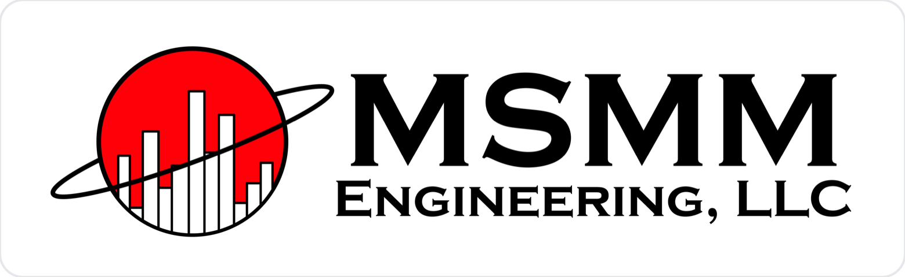
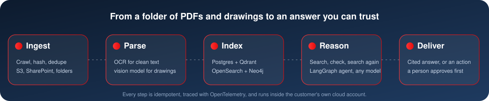

<!--
  Profile README for github.com/psanghani-msmm
  Artwork lives in assets/ and is generated by tools/build_assets.py.
-->

 

  

 

## 👋 About me

I'm an AI developer at **MSMM Engineering**, where I design and ship the AI products the firm runs on: retrieval systems over decades of engineering records, an agent toolkit every product plugs into, and a proposal builder that drafts federal SF 330 submissions from a knowledge base.

Most of my work is in private repositories, so this page is the tour. The short version:

- **I build end to end.** Python services, TypeScript front ends, PostgreSQL schemas, AWS infrastructure as code, CI gates, and the evals that say whether the model is actually right.
- **I care about trust.** Every answer carries citations that point at real passages. Every side effect pauses for a human. Document text never reaches a log.
- **I write things down.** Architecture decision records, event contracts, changelogs, and readiness checklists travel with the code.

 

 

## 🚀 Featured projects

<table>
<tr>
<td width="50%" valign="top">

### 🧠 Agentic AI toolkit
<b>Sole author · 1,100+ commits · Python · LangGraph</b>

A plug-and-play agent library for every MSMM product. Describe your product in one YAML file and get an agent that searches your documents, answers with citations, drafts documents, and acts only with a person's approval.

**What I built**
- Question flow that understands, searches by keyword and meaning, judges the passages, and searches again before answering from them alone
- Document generation: outline confirmed by a person, one helper per section, an evaluator that grades every section for faithfulness and citations
- Action gate: every write, email or record creation pauses on an approval card that survives a restart
- One interface over Anthropic, OpenAI-compatible endpoints (Ollama, vLLM) and Amazon Bedrock
- Egress policy (`none`, `allowlist`, `open`) that switches off every outside connection at start-up
- Eval harness: MultiHop-RAG, BFCL action grading, load and chaos checks against the live server

     

</td>
<td width="50%" valign="top">

### 📝 Fulcrum v2.0
<b>Lead engineer · 1,300+ commits · FastAPI · React · AWS CDK</b>

MSMM's SF 330 proposal builder. A team opens a pursuit, reads the solicitation with AI, staffs the team, picks past projects, and drafts the submission section by section on top of a proposal knowledge base.

**What I built**
- Solicitation reader that extracts requirements, factor weights and submission limits, and tracks amendments in place
- Staffing board with key positions, partner-firm outreach, and best-fit ranking of every partner from one line of facts
- Section-by-section drafting with scoped AI turns, an AI review against the solicitation, and undo on every edit
- Patch-based document versioning and a renderer that produces the SF 330 PDF
- Project sheets and firm resumes read by AI into reviewable records
- CDK infrastructure deployed from CI through OIDC, with drift reported but never applied by CI

     

</td>
</tr>
<tr>
<td width="50%" valign="top">

### 🏗️ Civil engineering RAG platform
<b>Core contributor · 700+ commits · multimodal · multi-tenant</b>

A self-hosted retrieval platform over an engineering firm's whole file system: specs, drawings, reports and bills of quantities. Two-tier parsing (OCR for text, a vision model for drawings), four indexes, hybrid retrieval with reranking, and cited answers. One codebase, one EKS cluster per tenant.

**What I built**
- Agentic chat on the live API: the agent proposes, the API performs, approval cards and progress frames stream into the chat
- Documents workspace rebuilt for scale: browse one tree level per request, composite detail routes with ETag/304, gzip, query budgets
- Corpus-wide search across every token, first-page PDF thumbnails, move and folder flows
- Native-PDF fast path so born-digital files skip render and OCR, and cached steps so a replay never wakes a GPU pool
- Spot GPU embedding pool that wakes on demand, pre-warms, and alerts when it stays resident
- Admin tooling for dead-letter rows and Temporal workflows

     

</td>
<td width="50%" valign="top">

### 📐 BlueprintAI
<b>Author · Fargate · Bedrock vision · pgvector</b>

An AI-powered registry for engineering drawings. Upload PDF, DXF, DWG or RVT files, browse every sheet, and ask questions that come back with citations to the exact sheet and region.

**What I built**
- Ingestion on Fargate: Textract for text, Claude vision through Bedrock for sheet components, embeddings into Postgres with pgvector
- Cited question answering over the registry, with chats owned and scoped per viewer
- Role-based access control with a view-only level, page gates and sheet scoping
- Dashboard with activity trend, type breakdown and pipeline panel, plus a fluid, device-agnostic token system for the UI
- Soft delete, user accounts and listing filters for day-to-day operation

    

</td>
</tr>
</table>

<b>More things I've shipped</b>

 

| Project | What it is | What I did |
|---|---|---|
| **Proposal knowledge base** | The database behind Fulcrum: every past proposal parsed into people, projects, roles and narratives | Ingest and clean-up tools, schema design, typed derived tables, a local viewer |
| **Fulcrum Lever** | The first proposal-review app: upload a submission, see what was read, talk to a draft | Section parsers, fact overrides with history, artwork approval, SF 330 rendering, CI deploys |
| **Parish Intelligence web app** | Next.js 15 / React 19 front end for cited document chat, document management, email and dashboards | Documents workspace cutover, fetch plumbing and resource cache, admin views, CVE upgrades |
| **Browser automation demo** | Selenium against an awkward page: delayed modal, ad overlay, server-confirmed votes | Parallel workers, headless and headed modes, a stdlib-only local server |

 

## 🛠️ Stack

**Languages and frameworks**

**Data, AI and infrastructure**

 

 

## 🧭 How I work

<table>
<tr>
<td width="33%" valign="top">

**Decisions on paper** 
Every non-obvious choice gets an architecture decision record. The toolkit alone has thirty, each naming the option taken and the ones turned down.

</td>
<td width="33%" valign="top">

**Contracts, not vibes** 
Audit events, API shapes and YAML configs are versioned contracts with tests that pin them. A breaking change bumps the number and ships a migration note.

</td>
<td width="33%" valign="top">

**Measured before merged** 
Sealed eval sets, load checks and chaos cases (a store that hangs, a model that goes down) run in CI. The readiness checklist names a test for every control.

</td>
</tr>
</table>

 

## 📈 Activity

<picture>
  <source media="(prefers-color-scheme: dark)" srcset="https://raw.githubusercontent.com/psanghani-msmm/psanghani-msmm/output/github-snake-dark.svg">
  <source media="(prefers-color-scheme: light)" srcset="https://raw.githubusercontent.com/psanghani-msmm/psanghani-msmm/output/github-snake.svg">
  
</picture>

Most of my commits land in private organisation repositories.

 

**Working on something that reads documents, answers questions, or needs an agent you can trust? I'd like to hear about it.**

